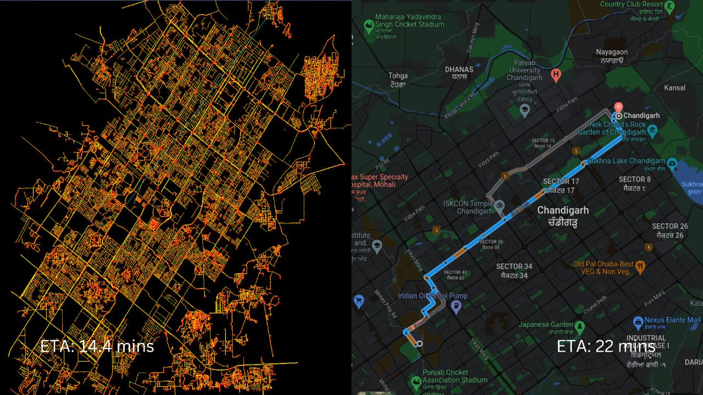

# 🚦 Smart Vehicle Routing

A system designed to calculate the **safest and shortest route** for emergency vehicles using a **Modified A* Algorithm** and **YOLO for obstacle detection**.  
The project aims to outperform traditional navigation systems (e.g., Google Maps) by factoring in **real-time safety constraints**.

---

## 📌 Features
- ✅ **Modified A\* Algorithm** to compute both shortest and safest routes.  
- ✅ **YOLO-based obstacle detection** to identify and avoid hazards in real-time.  
- ✅ **Traffic-light module** for adaptive route planning.  
- ✅ **UI representation** for visualizing routes.  
- ✅ On average, the proposed system **outperforms Google Maps by ~33%** in route safety and efficiency.  

---

## 🛠️ Tech Stack
- **Languages:** C++, Python  
- **Algorithms:** Modified A*, YOLO (for object detection)  
- **Database:** SQLite  
- **Visualization:** UI components, Map files (.osm)  

---

### 🗺️ Route Comparison

